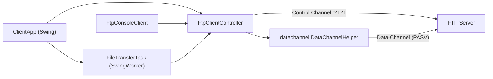

# MODULE CLIENT (GIAO DIỆN & KẾT NỐI)

**Phụ trách phát triển**: Nguyễn Anh Vũ (MSSV: 2380602582)  
**Môn học**: Lập trình mạng máy tính - Lớp: 23DTHB4 - Nhóm 11  
**Công nghệ sử dụng**: Java Swing UI, Socket client (`java.net.Socket`), `SwingWorker`.

---

## 1. Chức năng đã hoàn thành

- [x] **Giao diện người dùng (Swing UI)** – `ClientApp.java`
  - Khung đăng nhập: IP Server, Port (mặc định `2121`), Username, Password.
  - Bảng danh sách tệp/thư mục (`JTable`): Tên (có icon), Loại, Kích thước, Ngày sửa đổi, Quyền. Bấm tiêu đề cột để sắp xếp.
  - Thanh đường dẫn thư mục hiện tại (gõ đường dẫn rồi Enter để `CWD`) và nút **↑ Lên** (`CDUP`).
  - Các nút: **Làm mới**, **Tải lên**, **Tải xuống**, **Tạo thư mục**, **Xóa**; menu chuột phải; kéo thả tệp từ Explorer để tải lên.
  - Thanh tiến trình `JProgressBar`: %, số byte đã truyền / tổng, tốc độ (KB/s, MB/s), thứ tự tệp (vd. `[2/5]`), nút **Hủy**.
  - Khung Log `JTextArea`: hiển thị mọi lệnh gửi đi (`>>`) và phản hồi Server (`<<`) kèm giờ; ô **Lệnh FTP** để gõ lệnh thủ công.
- [x] **Xử lý mạng phía Client** – `FtpClientController.java`
  - Kết nối Control Socket (cổng `2121`), đọc banner `220`, đăng nhập `USER`/`PASS`, chuyển `TYPE I`.
  - Đọc phản hồi một dòng và **nhiều dòng** (`211-...`, `214-...`) theo RFC 959.
  - Passive Mode: `PASV` → tách `(h1,h2,h3,h4,p1,p2)` → `port = p1 * 256 + p2` → mở Data Socket → gửi `LIST`/`RETR`/`STOR` → truyền byte → đóng Data Socket → nhận `226`.
  - Truyền byte và báo tiến độ qua `datachannel.DataChannelHelper` + `DataTransferListener` (module của Trọng).
  - Tự gửi `NOOP` mỗi 60 giây để Server không ngắt phiên (Server timeout 120 giây).
  - Hủy truyền giữa chừng: tải xuống dở sẽ xóa tệp cục bộ; tải lên dở sẽ gửi `DELE` xóa tệp hỏng trên Server.
- [x] **Client dòng lệnh (console)** – `FtpConsoleClient.java`, dùng chung `FtpClientController`, có thanh tiến trình dạng văn bản.

---

## 2. Cấu trúc mã nguồn

| Tệp | Vai trò |
| :--- | :--- |
| `ClientApp.java` | Giao diện Swing (JFrame chính), xử lý sự kiện người dùng |
| `FtpClientController.java` | Quản lý Control Channel, Passive Mode, LIST / RETR / STOR / DELE / MKD / RMD / SIZE ... |
| `FileTransferTask.java` | `SwingWorker` truyền tệp nền (nhiều tệp liên tiếp), cập nhật `JProgressBar`, hỗ trợ hủy |
| `FtpFileEntry.java` | Phân tích một dòng kết quả `LIST` (định dạng UNIX `ls -l`, hỗ trợ tên có khoảng trắng) |
| `FtpResponse.java` | Đối tượng phản hồi Server (mã 3 chữ số + thông điệp) |
| `FtpConsoleClient.java` | Client chế độ dòng lệnh |
| `FtpClientStub.java` | Lớp khung cũ, nay chỉ chuyển sang `ClientApp` |
| `BienDichClient.bat` / `ChayClient.bat` / `ChayClientConsole.bat` | Biên dịch / chạy GUI / chạy console |



---

## 3. Yêu cầu

- **JDK 8 trở lên** (đã kiểm thử với JDK 21). Kiểm tra: `java -version` và `javac -version`.
- Server của nhóm đang chạy (`server\ChayServer.bat`) hoặc bất kỳ FTP Server nào hỗ trợ `PASV`.

---

## 4. Biên dịch & chạy

### Cách 1 – Dùng file .bat (Windows, khuyên dùng)

Chạy từ thư mục gốc dự án hoặc nhấp đúp trong Explorer:

1. Khởi động Server: `server\ChayServer.bat`
2. Biên dịch Client: `client\BienDichClient.bat`  
   *(Có thể bỏ qua – các file chạy bên dưới sẽ tự biên dịch nếu chưa có.)*
3. Chạy giao diện Swing: `client\ChayClient.bat`  
   hoặc client dòng lệnh: `client\ChayClientConsole.bat`

### Cách 2 – Dòng lệnh thủ công (Windows / Linux / macOS)

Đứng tại **thư mục gốc dự án**:

```bash
# Biên dịch (client phụ thuộc module datachannel)
javac -encoding UTF-8 -d bin datachannel/*.java client/*.java

# Chạy GUI (tham số tùy chọn: host port)
java -cp bin client.ClientApp
java -cp bin client.ClientApp 192.168.1.10 2121

# Chạy console (tham số tùy chọn: host port user pass)
java -cp bin client.FtpConsoleClient
java -cp bin client.FtpConsoleClient 127.0.0.1 2121 vu 123456
```

> [!NOTE]
> Trên PowerShell, tham số `-D...` phải đặt trong ngoặc kép, ví dụ: `java "-Dfile.encoding=UTF-8" -cp bin client.ClientApp`.

---

## 5. Hướng dẫn sử dụng giao diện Swing

### 5.1. Đăng nhập
1. Nhập **Host** (vd. `127.0.0.1`), **Port** (`2121`), **User**, **Pass**.
2. Bấm **Kết nối** (hoặc nhấn Enter ở ô Pass).
3. Thành công: khung Log hiện `220` → `331` → `230`, bảng hiển thị nội dung thư mục gốc `/`.

Tài khoản mặc định của Server nhóm:

| User | Pass |
| :--- | :--- |
| `vu` / `tien` / `trong` | `123456` |
| `admin` | `admin123` |
| `test` | `test` |
| `anonymous` | *(bất kỳ)* |

### 5.2. Duyệt thư mục
| Thao tác | Cách làm | Lệnh FTP gửi đi |
| :--- | :--- | :--- |
| Vào thư mục | Nhấp đúp vào thư mục / chọn rồi nhấn Enter | `CWD <tên>` + `PWD` + `PASV` + `LIST` |
| Lên thư mục cha | Nút **↑ Lên** / phím Backspace | `CDUP` |
| Đi tới đường dẫn | Gõ vào ô *Thư mục hiện tại* (vd. `/tailieu`) rồi Enter hoặc **Đi tới** | `CWD /tailieu` |
| Làm mới | Nút **Làm mới** / phím F5 | `PWD` + `PASV` + `LIST` |

### 5.3. Tải lên (Upload)
- Bấm **Tải lên** → chọn một hoặc nhiều tệp (giữ Ctrl/Shift), **hoặc**
- Kéo thả tệp từ Windows Explorer vào bảng danh sách.
- Nếu tệp đã tồn tại trên Server, Client hỏi có ghi đè không.
- Thanh tiến trình hiển thị `% – đã gửi / tổng – tốc độ`. Xong sẽ tự làm mới danh sách.

### 5.4. Tải xuống (Download)
- Chọn tệp → bấm **Tải xuống** (hoặc nhấp đúp vào tệp).
- Một tệp: chọn nơi lưu và tên tệp. Nhiều tệp: chọn thư mục lưu.
- Client gửi `SIZE` để biết tổng dung lượng, sau đó `PASV` + `RETR`.

### 5.5. Hủy truyền tải
Bấm **Hủy** bên phải thanh tiến trình. Client đóng Data Socket; tệp dở dang sẽ được xóa (cục bộ khi tải xuống, trên Server khi tải lên).

### 5.6. Tạo / xóa
- **Tạo thư mục** → nhập tên → `MKD`.
- **Xóa** (hoặc phím Delete) → xác nhận → `DELE` cho tệp, `RMD` cho thư mục (thư mục phải rỗng).
- Chuột phải vào tệp có thêm **Xem kích thước (SIZE)**.

### 5.7. Gõ lệnh FTP thủ công
Ô **Lệnh FTP** ở cuối khung Log cho phép gửi lệnh trực tiếp và xem phản hồi nguyên văn, ví dụ:

```
PWD            NOOP           SYST           FEAT          HELP
SIZE welcome.txt              MKD baocao     RMD baocao    CWD tailieu
LIST           NLST           (Client tự gửi PASV và in dữ liệu nhận qua Data Channel)
RETR <tên>     STOR           (mở hộp thoại tải xuống / tải lên)
QUIT           (ngắt kết nối)
```

> [!TIP]
> `USER`/`PASS` hãy dùng khung đăng nhập; `PASV`/`PORT` không cần gõ vì Client tự xử lý khi truyền dữ liệu.

### 5.8. Đọc khung Log
```
[02:13:22] >> PASV                                   <- Client gửi lệnh
[02:13:22] << 227 Entering Passive Mode (127,0,0,1,195,80).
[02:13:22] *** Mở Data Channel tới 127.0.0.1:50000 (port = 195 * 256 + 80)
[02:13:22] >> LIST
[02:13:22] << 150 Mo ket noi Data Channel de truyen danh sach tep tin.
[02:13:22] << 226 Da truyen xong danh sach tep tin.
```
- `>>` lệnh gửi đi, `<<` phản hồi Server, `***` thông tin Client, `!!!` lỗi. Mật khẩu luôn hiển thị là `PASS ******`.

---

## 6. Hướng dẫn sử dụng Client dòng lệnh

```
ftp> open 127.0.0.1 2121        (hỏi User / Pass)
ftp> ls
ftp> cd tailieu
ftp> get huong_dan_ftp.txt D:\Downloads
[##############################] 100%  375 B / 375 B  12.0 KB/s
ftp> put "D:\bao cao.docx"
ftp> quit
```

| Lệnh | Mô tả |
| :--- | :--- |
| `open <host> [port]` | Kết nối và đăng nhập |
| `ls` / `dir` | Liệt kê tệp (`PASV` + `LIST`) |
| `pwd`, `cd <dir>`, `cd ..`, `cdup` | Xem / đổi thư mục |
| `get <remote> [local]` | Tải xuống, có thanh tiến trình |
| `put <local> [remote]` | Tải lên, có thanh tiến trình |
| `del <file>`, `mkdir <dir>`, `rmdir <dir>` | Xóa tệp / tạo / xóa thư mục |
| `size <file>` | Xem dung lượng |
| `quote <LỆNH>` | Gửi lệnh FTP thô, vd. `quote SYST` |
| `verbose` | Bật / tắt in log Control Channel |
| `close`, `quit` | Ngắt kết nối / thoát |

Tên có khoảng trắng: đặt trong ngoặc kép, ví dụ `get "bao cao.txt"`.

---

## 7. Xử lý sự cố

| Hiện tượng | Nguyên nhân / Cách khắc phục |
| :--- | :--- |
| `Connection refused` | Server chưa chạy hoặc sai Port. Chạy `server\ChayServer.bat`, kiểm tra cổng `2121`. |
| `530 Dang nhap that bai` | Sai User / Pass (xem bảng tài khoản ở mục 5.1). |
| Treo khi `LIST` / tải tệp, rồi báo timeout | Tường lửa chặn dải cổng Passive `50000-50100` trên máy Server. Mở dải cổng này hoặc tắt tường lửa khi thử nghiệm qua LAN. |
| `550 ...` | Tệp/thư mục không tồn tại, thư mục chưa rỗng (khi `RMD`), hoặc đường dẫn ra ngoài thư mục gốc của Server. |
| `Server đã đóng kết nối Control Channel` | Server bị tắt hoặc phiên hết hạn. Bấm **Kết nối** lại. |
| Lỗi font tiếng Việt trong CMD (console) | Dùng `ChayClientConsole.bat` (đã đặt `chcp 65001`) hoặc chạy trong Windows Terminal. |
| `javac` không được nhận diện | Cài JDK và thêm thư mục `bin` của JDK vào biến môi trường `PATH`. |
